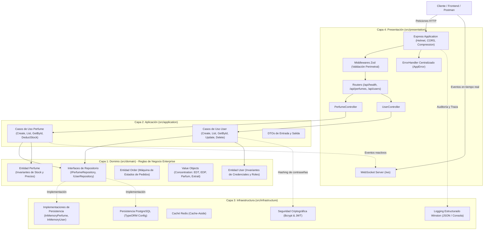

# 23122668 - ALAN ABRAHAM PEÑA NAVA
Repositorio de Desarrollo Backend 2026-I (23122668)
Universidad Autónoma de Sinaloa - Facultad de Ingeniería Mochis
Licenciatura en Ingeniería de Software — 7.º Semestre
Materia: Desarrollo Backend de Aplicaciones | Titular: Dr. Herman Geovany Ayala Zúñiga

---

# BL FRAGANCIAS - Backend API (Clean Architecture)

Backend estructurado, escalable y con tipado estricto para **BL FRAGANCIAS**, sistema de comercio electrónico y control de inventario de perfumería fina.

El diseño sigue los principios de **Arquitectura Limpia (Clean Architecture)**, **Diseño Guiado por el Dominio (DDD)** y separación rigurosa de responsabilidades en 4 capas desacopladas.

---

## Especificación de Requisitos del Sistema (SRS)

Para consultar la especificación exhaustiva y formal de los requisitos de ingeniería de software con sus criterios de aceptación y matriz de trazabilidad, diríjase al documento dedicado:
* [**Especificación Completa de Requisitos (REQUISITOS.md)**](./REQUISITOS.md)

### Resumen de Requisitos Funcionales (RF)
- **RF-01 a RF-07 (Catálogo e Inventario):** Registro de fragancias, consulta con filtros concurrentes, detalle por ID, deducción atómica de existencias con bloqueo de invariante de dominio (`InsufficientStockError` -> 409 Conflict), reabastecimiento, actualización de precios y depuración.
- **RF-08 a RF-12 (Gestión de Usuarios y Accesos):** Alta de usuarios con validación de unicidad de correo y username, consulta por ID o listado, actualización de perfil, control estricto de roles (`Admin` y `Customer`) y baja de cuentas.
- **RF-13 y RF-14 (Órdenes y Ventas):** Creación de pedidos con cálculo automático de importes y control de ciclo de vida mediante máquina de estados finitos (`PENDING` -> `PAID` -> `SHIPPED` -> `DELIVERED`).
- **RF-15 y RF-16 (Tiempo Real y Monitoreo):** Difusión de eventos de inventario en vivo vía WebSockets (`/ws`) y endpoint de salud operacional `GET /api/health`.

### Resumen de Requisitos No Funcionales (RNF)
- **RNF-01 (Clean Architecture):** 4 capas concéntricas con regla de dependencia unidireccional hacia adentro y 0 dependencias externas en la capa de Dominio.
- **RNF-02 (Tipado Estricto):** TypeScript con `strict: true`, `noImplicitAny: true`, `strictNullChecks: true` y compilación limpia con 0 errores.
- **RNF-03 y RNF-04 (Seguridad Perimetral):** Protección de cabeceras HTTP mediante Helmet (HSTS, nosniff, no-sniffing) y control de orígenes cruzados (CORS).
- **RNF-05 y RNF-06 (Validación y Errores):** Validación perimetral exhaustiva con Zod y manejo centralizado de excepciones vía `AppError` con códigos semánticos (400, 404, 409, 500).
- **RNF-07 (Seguridad Criptográfica):** Hashing de contraseñas con Bcrypt (cost factor >= 10) y tokens stateless con JWT.
- **RNF-08 y RNF-09 (Rendimiento):** Compresión de tráfico HTTP (Gzip/Deflate) y aceleración de consultas mediante caché (patrón Cache-Aside con TTL).
- **RNF-10 y RNF-11 (Observabilidad y Conectividad):** Logging estructurado con Winston (ISO 8601 y JSON) y canal full-duplex WebSocket (`/ws`).
- **RNF-12 (Verificabilidad):** Cobertura de pruebas automatizadas unitarias y de integración con Jest (`npm test`).

---

## Diagrama de Arquitectura de Capas (C4 Nivel 2 - Contenedores y Componentes)



---

## Estructura de Capas (Clean Architecture)

El código fuente se organiza dentro del directorio `src/` en 4 capas concéntricas:

```
src/
├── domain/                  # [CAPA 1] Reglas de Negocio Enterprise
│   ├── entities/            # Entidades ricas con métodos que garantizan invariantes (Perfume, User, Order)
│   ├── value-objects/       # Tipos y Value Objects inmutables (Concentration)
│   ├── errors/              # Errores puros de dominio (DomainError, InsufficientStockError)
│   ├── repositories/        # Interfaces abstractas de repositorios (IPerfumeRepository, IUserRepository)
│   └── index.ts             # REGLA ESTRICTA: 0 dependencias externas (sin Express, TypeORM, etc.)
│
├── application/             # [CAPA 2] Casos de Uso y Orquestación
│   ├── dtos/                # Data Transfer Objects de entrada y salida (CreatePerfumeDTO, UserDTO)
│   ├── use-cases/           # Casos de uso de Perfume y User con Inyección de Dependencias
│   └── index.ts             # Desacoplada: Solo interactúa mediante interfaces del dominio
│
├── infrastructure/          # [CAPA 3] Adaptadores y Servicios Externos
│   ├── persistence/         # Implementaciones de persistencia (InMemory, TypeORM PostgreSQL)
│   ├── cache/               # Implementación de caché Redis (Patrón Cache-Aside)
│   ├── security/            # Hashing seguro con Bcrypt (costo >= 10) y tokens JWT stateless
│   ├── logging/             # Logging estructurado con Winston (Consola y JSON con timestamp ISO)
│   └── index.ts
│
├── presentation/            # [CAPA 4] Entrada, Transporte y API
│   ├── controllers/         # PerfumeController y UserController (manejo de req, res y códigos HTTP)
│   ├── routes/              # Routers Express modularizados (/api/health, /api/perfumes, /api/users)
│   ├── middlewares/         # Validación perimetral Zod y manejador centralizado de errores
│   ├── schemas/             # Esquemas de validación Zod (body, query, params)
│   ├── errors/              # AppError con status codes HTTP semánticos y detalles operacionales
│   ├── websockets/          # Servidor WebSocket para notificaciones en vivo (/ws)
│   └── app.ts               # Ensamblador de Express (Helmet, CORS, compresión gzip)
│
└── server.ts                # Bootstrap del servidor y Composition Root
```

---

## Entidades Principales del Dominio

### 1. `Perfume`
- **Atributos:** `id`, `name`, `brand`, `concentration` (`'EDT' | 'EDP' | 'Parfum' | 'Extrait'`), `sizeMl`, `price`, `stock`, `createdAt`, `updatedAt`.
- **Invariantes y Métodos:**
  - `deductStock(quantity: number)`: Valida existencia y descuenta stock. Si el stock es insuficiente, lanza `InsufficientStockError`.
  - `addStock(quantity: number)`: Valida e incrementa stock en inventario.
  - `updatePrice(newPrice: number)`: Valida que el precio sea mayor a 0 y actualiza la fecha de modificación.

### 2. `User`
- **Atributos:** `id`, `fullname`, `username`, `email`, `passwordHash`, `role` (`'Admin' | 'Customer'`), `createdAt`, `updatedAt`.
- **Invariantes y Métodos:**
  - `updateProfile(fullname, email)`: Valida formatos de correo y nombre obligatorio.
  - `updatePasswordHash(newHash)`: Valida rotación de credenciales criptográficas.
  - `changeRole(newRole)`: Valida roles permitidos en el sistema.

### 3. `Order`
- **Atributos:** `id`, `customerId`, `items` (`perfumeId`, `quantity`, `unitPrice`, `subtotal`), `totalAmount`, `status` (`'PENDING' | 'PAID' | 'SHIPPED' | 'DELIVERED'`).
- **Máquina de Estados:** `markAsPaid()`, `ship()`, `deliver()`.

---

## Requisitos y Tecnologías

- **Node.js**: `>= 20.0.0`
- **TypeScript**: `5.7+` (`strict: true`, `noImplicitAny: true`, `strictNullChecks: true`)
- **Express**: Servidor web modular desacoplado
- **Helmet & CORS**: Seguridad HTTP y control de acceso
- **Compression**: Optimización Gzip de respuestas HTTP
- **Zod**: Validación perimetral exhaustiva (body, params, query)
- **Winston**: Logging estructurado en formato JSON
- **WebSockets (ws)**: Notificaciones de inventario en tiempo real en `/ws`
- **Bcrypt & JWT**: Seguridad criptográfica y tokens sin estado
- **Jest & Supertest**: Pruebas unitarias de dominio y de integración de endpoints
- **Husky & lint-staged**: Git Hooks automáticos en pre-commit
- **Commitlint**: Forzado de Conventional Commits en Git

---

## Comandos Disponibles

| Script | Descripción |
| :--- | :--- |
| `npm run dev` | Inicia el servidor en modo desarrollo con recarga rápida (`tsx watch src/server.ts`) |
| `npm run build` | Compila el proyecto TypeScript hacia JavaScript en `dist/` |
| `npm start` | Ejecuta el build compilado en producción (`node dist/server.js`) |
| `npm test` | Ejecuta la suite de pruebas unitarias y de integración con Jest |
| `npm run test:coverage` | Genera reporte de cobertura de código en `coverage/` |
| `npm run lint` | Ejecuta ESLint sobre el código fuente de TypeScript |
| `npm run format` | Da formato consistente al código mediante Prettier |

---

## Endpoints de la API REST

### Health Check (Obligatorio)
```http
GET /api/health
```
**Respuesta (200 OK):**
```json
{
  "status": "success",
  "system": "BL FRAGANCIAS API",
  "timestamp": "2026-10-06T11:00:00.000Z",
  "uptimeSeconds": 15,
  "environment": "development"
}
```

---

### Módulo 1: Catálogo de Fragancias e Inventario (`/api/perfumes`)

#### 1. Listar Catálogo con Filtros
```http
GET /api/perfumes?brand=Dior&concentration=Parfum&minPrice=1000&maxPrice=5000&inStockOnly=true
```

#### 2. Obtener Detalle de Perfume
```http
GET /api/perfumes/:id
```

#### 3. Registrar Nueva Fragancia (Validación Zod Perimetral)
```http
POST /api/perfumes
Content-Type: application/json

{
  "name": "Layton",
  "brand": "Parfums de Marly",
  "concentration": "EDP",
  "sizeMl": 125,
  "price": 6800.0,
  "stock": 10
}
```

#### 4. Deducir Stock (Ejecución de Invariante de Dominio)
```http
POST /api/perfumes/:id/deduct-stock
Content-Type: application/json

{
  "quantity": 2
}
```

---

### Módulo 2: Gestión de Usuarios (`/api/users`)

#### 1. Registrar Nuevo Usuario
```http
POST /api/users
Content-Type: application/json

{
  "fullname": "Alan Abraham Peña Nava",
  "username": "alanmasterpro",
  "email": "alanmasterpro25@gmail.com",
  "password": "PasswordSeguro2026!",
  "role": "Admin"
}
```

#### 2. Listar Usuarios Registrados
```http
GET /api/users
```

#### 3. Obtener Usuario por ID
```http
GET /api/users/:id
```

#### 4. Actualizar Usuario
```http
PUT /api/users/:id
Content-Type: application/json

{
  "fullname": "Alan Peña Actualizado",
  "email": "alan.nuevo@blfragancias.com"
}
```


#### 5. Eliminar Usuario
```http
DELETE /api/users/:id
```
